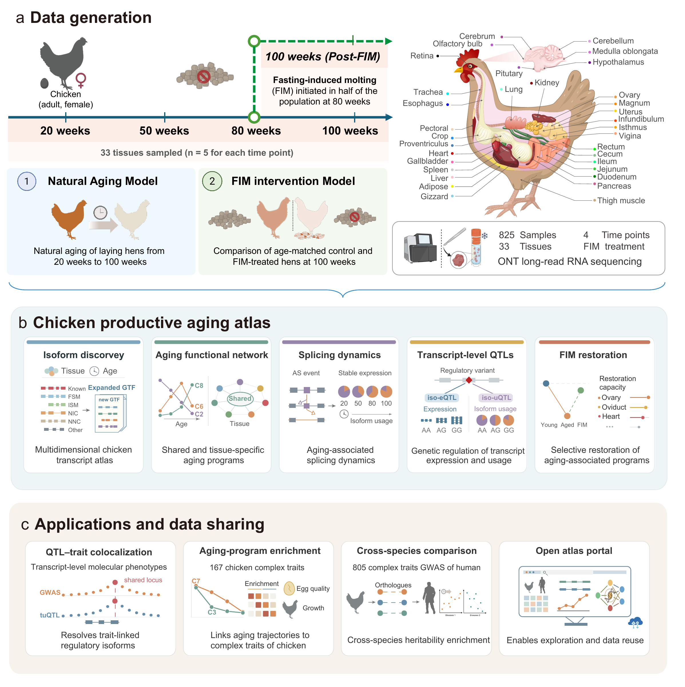

# Chicken Productive Aging Atlas

**A long-read RNA sequencing atlas of productive aging across 33 tissues in laying hens**

[Analysis pipelines](#analysis-pipelines) · [Getting started](#getting-started) · [Software](environment/README.md) · [Data and code availability](#data-and-code-availability) · [Citation](#citation)

## Introduction

Chicken Productive Aging Atlas uses Oxford Nanopore long-read RNA sequencing to characterize full-length transcript diversity, age-related expression and transcript usage across 33 tissues in laying hens. The study includes 25 hens: five biological replicates in each of four natural age groups (20, 50, 80 and 100 weeks) and five hens sampled at 100 weeks following induced forced molting (FIM), yielding 825 tissue samples.

The analyses combine transcriptome reconstruction, expression trajectories, alternative splicing, FIM recovery, DNA sequence modeling and allele-specific analyses. Integration with molecular QTLs from 18 overlapping ChickenGTEx tissues, chicken complex traits and cross-species functional annotations connects transcript-level variation to genetic regulation and function.

[](assets/Fig1.pdf)

*Figure 1. Study design and analysis overview.* [View the original PDF](assets/Fig1.pdf).

## Analysis pipelines

The repository contains **35 main analysis entries across eight modules**. Each entry links to its main script or component scripts; module documentation provides additional context and required helpers. The complete machine-readable list is available in the [analysis index](config/main_analyses.tsv).

| Module | Scope | Entries |
|---|---|---|
| [01_Transcriptome](script/01_Transcriptome/README.md) | Transcriptome reconstruction and annotation | 5 |
| [02_Expression_dynamics](script/02_Expression_dynamics/README.md) | Expression specificity and aging dynamics | 8 |
| [03_Splicing_and_usage](script/03_Splicing_and_usage/README.md) | Alternative splicing and transcript usage | 4 |
| [04_FIM](script/04_FIM/README.md) | FIM expression and usage recovery | 2 |
| [05_DNA_sequence_model](script/05_DNA_sequence_model/README.md) | DNA sequence model | 3 |
| [06_ASE_ASTS](script/06_ASE_ASTS/README.md) | ASE and ASTS | 3 |
| [07_Molecular_QTL](script/07_Molecular_QTL/README.md) | Molecular QTLs and GWAS integration | 6 |
| [08_Comparative_and_complex_traits](script/08_Comparative_and_complex_traits/README.md) | Comparative analyses and complex traits | 4 |

### 1. Transcriptome reconstruction and annotation

[Module documentation](script/01_Transcriptome/README.md)

- **01. Read processing** — [process_reads.sh](script/01_Transcriptome/01_Read_processing/process_reads.sh)
- **02. Transcript reconstruction and annotation merge** — [reconstruct_transcripts.sh](script/01_Transcriptome/02_Assembly/reconstruct_transcripts.sh); [merge_annotations.sh](script/01_Transcriptome/02_Assembly/merge_annotations.sh)
- **03. ORF annotation** — [annotate_orfs.sh](script/01_Transcriptome/03_ORF_annotation/annotate_orfs.sh)
- **04. Six-resource comparison** — [query_oriented_six_resources.py](script/01_Transcriptome/04_Reference_comparison/query_oriented_six_resources.py)
- **05. Short-read validation** — [validation.py](script/01_Transcriptome/05_Short_read_validation/validation.py)

### 2. Expression specificity and aging dynamics

[Module documentation](script/02_Expression_dynamics/README.md)

- **06. Requantification with the study annotation** — [requantify_group.sh](script/02_Expression_dynamics/01_Quantification/requantify_group.sh)
- **07. Specificity indices** — [run_tspex.R](script/02_Expression_dynamics/02_Specificity/run_tspex.R)
- **08. Transcriptomic timing** — [timing_score.R](script/02_Expression_dynamics/03_Timing/timing_score.R)
- **09. Age-related expression model** — [fit_age_expression.R](script/02_Expression_dynamics/04_Age_models/fit_age_expression.R)
- **10. Isoform dynamics** — [test_isoform_dynamics.py](script/02_Expression_dynamics/05_Isoform_dynamics/test_isoform_dynamics.py)
- **11. Within-tissue and pooled trajectory clustering** — Within each tissue (15 clusters): [within_tissue_zscore.R](script/02_Expression_dynamics/06_Clustering/within_tissue_zscore.R) → [within_tissue_loess.R](script/02_Expression_dynamics/06_Clustering/within_tissue_loess.R); pooled across tissues (10 clusters): [pooled_kmeans.py](script/02_Expression_dynamics/06_Clustering/pooled_kmeans.py)
- **12. GO enrichment** — [enrich_cluster_go.R](script/02_Expression_dynamics/07_GO_enrichment/enrich_cluster_go.R)
- **13. Motif enrichment** — [run_ame.sh](script/02_Expression_dynamics/08_Motif/run_ame.sh)

### 3. Alternative splicing and transcript usage

[Module documentation](script/03_Splicing_and_usage/README.md)

- **14. SUPPA events and isoform fractions** — [suppa_analysis.sh](script/03_Splicing_and_usage/01_SUPPA/suppa_analysis.sh)
- **15. PSI statistics** — [fit_original_PSI.R](script/03_Splicing_and_usage/03_Isoform_PSI/fit_original_PSI.R)
- **16. Count-based DTU** — [fit_usage.R](script/03_Splicing_and_usage/02_Count_DTU/fit_usage.R)
- **17. Usage trajectories** — [cluster_psi.py](script/03_Splicing_and_usage/04_Usage_clusters/cluster_psi.py)

### 4. FIM expression and usage recovery

[Module documentation](script/04_FIM/README.md)

- **18. FIM expression changes and recovery** — [fit_fim_expression.R](script/04_FIM/01_Expression_recovery/fit_fim_expression.R); [expression_recovery_index.py](script/04_FIM/01_Expression_recovery/expression_recovery_index.py)
- **19. Usage recovery** — [fit_fim_usage.R](script/04_FIM/02_Usage_recovery/fit_fim_usage.R)

### 5. DNA sequence model

[Module documentation](script/05_DNA_sequence_model/README.md)

- **20. Model training data preparation** — [prepare_model_inputs.py](script/05_DNA_sequence_model/prepare_model_inputs.py); [prepare_tfrecords_33.py](script/05_DNA_sequence_model/prepare_tfrecords_33.py)
- **21. Train the 33-tissue model** — [train_main_model.sh](script/05_DNA_sequence_model/train_main_model.sh)
- **22. Evaluate coverage and end usage** — [evaluate_model_33.py](script/05_DNA_sequence_model/evaluate_model_33.py)

### 6. ASE and ASTS

[Module documentation](script/06_ASE_ASTS/README.md)

- **23. WGS variant calling** — [wgs_variant_calling.sh](script/06_ASE_ASTS/01_WGS/wgs_variant_calling.sh)
- **24. ASE and ASTS analysis** — [call_ase.sh](script/06_ASE_ASTS/02_LORALS/call_ase.sh); [call_asts.sh](script/06_ASE_ASTS/02_LORALS/call_asts.sh)
- **25. Allelic-effect and QTL association** — [test_allelic_qtl_associations.R](script/06_ASE_ASTS/03_QTL_correspondence/test_allelic_qtl_associations.R)

### 7. Molecular QTLs and GWAS integration

[Module documentation](script/07_Molecular_QTL/README.md)

- **26. iso-eQTL mapping** — [run_transcript_eqtl_standard.sh](script/07_Molecular_QTL/01_Phenotypes_and_mapping/transcript_eqtl_standard_pipeline/scripts/run_transcript_eqtl_standard.sh)
- **27. iso-uQTL preprocessing and mapping** — [run_iso_uqtl.py](script/07_Molecular_QTL/01_Phenotypes_and_mapping/iso_uqtl_mapping/run_iso_uqtl.py)
- **28. SuSiE fine-mapping** — [run_susie.py](script/07_Molecular_QTL/02_Fine_mapping/run_susie.py)
- **29. Conditional QTLs** — [map_conditional_qtl.py](script/07_Molecular_QTL/03_Conditional/map_conditional_qtl.py)
- **30. Tissue sharing** — [tissue_sharing.R](script/07_Molecular_QTL/04_Tissue_sharing/tissue_sharing.R)
- **31. GWAS colocalization and SMR** — [run_coloc.R](script/07_Molecular_QTL/05_GWAS_coloc_SMR/run_coloc.R); [run_smr.sh](script/07_Molecular_QTL/05_GWAS_coloc_SMR/run_smr.sh)

### 8. Comparative analyses and complex traits

[Module documentation](script/08_Comparative_and_complex_traits/README.md)

- **32. Mammalian aging signatures** — [gradient_01_genes.py](script/08_Comparative_and_complex_traits/01_Mammalian_signatures/gradient_01_genes.py)
- **33. Functional programmes** — [compare_functional_programs.py](script/08_Comparative_and_complex_traits/02_Functional_programs/compare_functional_programs.py)
- **34. Chicken trait enrichment of expression and usage sets** — Expression-defined sets: [gwas_enrichment_expression.R](script/08_Comparative_and_complex_traits/03_Chicken_GWAS/gwas_enrichment_expression.R); usage-defined sets: [gwas_enrichment_usage.R](script/08_Comparative_and_complex_traits/03_Chicken_GWAS/gwas_enrichment_usage.R)
- **35. Human trait heritability enrichment** — [run_ldsc.sh](script/08_Comparative_and_complex_traits/04_Human_LDSC/run_ldsc.sh)

## Getting started

Install the software required for the selected module using the [environment notes](environment/README.md), and prepare the files described in the [input guide](docs/INPUTS.md). Configure a separate analysis directory with:

```bash
python tools/prepare_workspace.py --root /scratch/chicken-aging --dry-run
python tools/prepare_workspace.py --root /scratch/chicken-aging
```

Replace `/scratch/chicken-aging` with your analysis directory. Documentation placeholders such as `{tissue}`, `{sample}`, `{input_file}` and `{output_dir}` must be replaced with your values. Scripts receive these values through arguments or manifests; full-cohort tissue lists and model channel order are study metadata.

Follow the relevant module instructions to run its components. Grouped entries retain their constituent scripts. In the tab-separated analysis index, semicolons separate component paths in the `entrypoint` field; the field is a list of paths, not a shell command.

## Data and code availability

This repository contains the principal analysis code and supporting configurations for Chicken Productive Aging Atlas. Data accessions, the atlas portal URL and links to model weights will be added when available.

## Citation

The study citation and DOI will be added here once the preprint is available.

## Acknowledgments

We thank everyone who contributed to this project.
